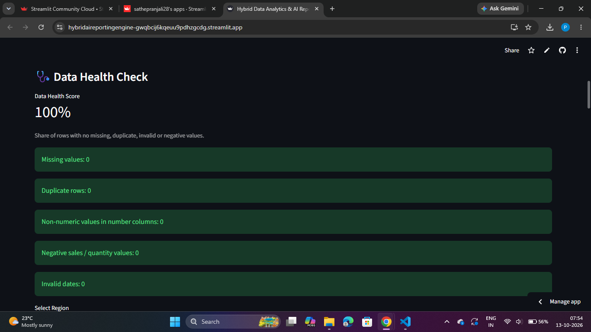
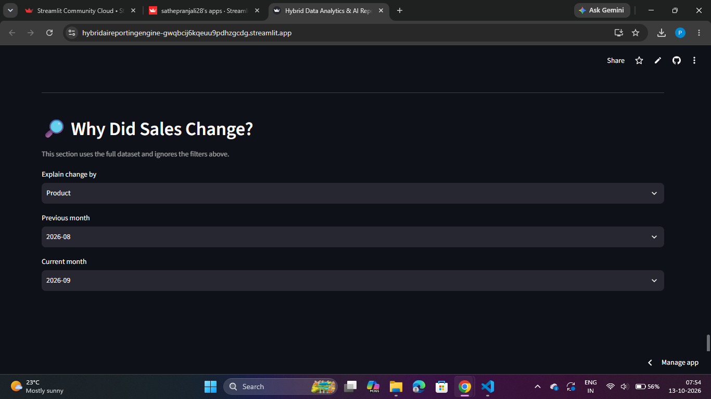
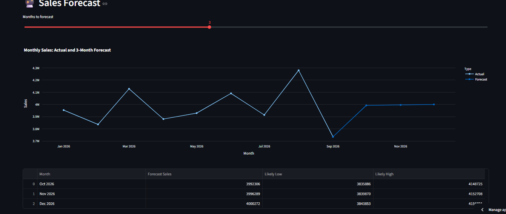
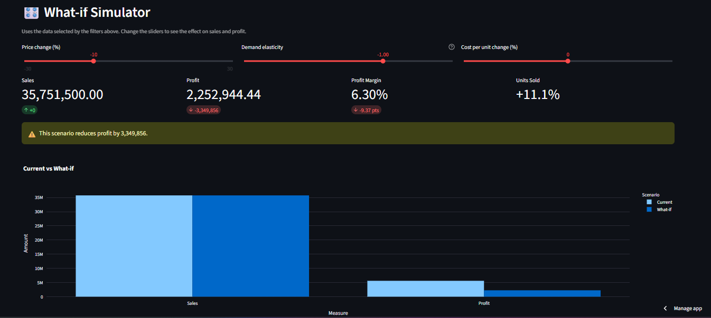

# 📊 Hybrid Data Analytics & AI Reporting Engine

Live app: https://hybridaireportingengine-gwqbcij6kqeuu9pdhzgcdg.streamlit.app/

## Problem
Small businesses often keep sales data in messy Excel files and have no analyst.
They cannot tell whether the data is reliable, why sales went up or down, or what may happen next.

## Solution
Upload a CSV or Excel file and the app:
1. Checks data quality and gives a Data Health Score.
2. Shows sales and profit trends (daily, weekly, monthly).
3. Explains why sales changed between two months, ranked by product or region.
4. Forecasts the next 1 to 6 months of sales.
5. Lets you test price, demand and cost scenarios in a What-if Simulator.
6. Flags unusual records (anomalies).
7. Generates a business report as DOCX or PDF.

## Features
- Data Health Check: missing values, duplicates, invalid dates, negative values
- Filters by region, product and date range
- Profit margin and top/weakest product and region insights
- "Why Did Sales Change?" month-to-month comparison
- Sales Forecast: straight-line trend on complete months, with a likely low and high range
- What-if Simulator: change price, demand elasticity and cost per unit to see new sales, profit and margin
- Anomaly detection (IQR rule, compared within each product)
- Downloadable DOCX and PDF reports

## Screenshots

## Limits (please read)
- The forecast is a simple straight-line trend. It does not know about seasons, festivals or promotions, so use it as a guide, not a promise.
- In the What-if Simulator, demand elasticity is an assumption chosen by the user. It is not learned from the data.

## Tech Stack
Python, Streamlit, Pandas, NumPy, Plotly, python-docx, ReportLab

## Project Structure
- Src/app.py : main Streamlit app
- Src/engine_helpers.py : data health check, formatting, DOCX/PDF report builders
- Src/engine_insights.py : dashboard, insights, "Why did sales change?"
- Src/engine_predict.py : forecast, what-if simulator, anomaly detection
- Data/sales_data.csv : sample dataset

## Run locally
    pip install -r requirements.txt
    streamlit run Src/app.py

## Sample data
`Data/sales_data.csv` is a synthetic sample dataset (1,000 rows) generated for demonstration.
Run `python make_data.py` to regenerate it. You can also upload your own CSV or Excel file in the app.